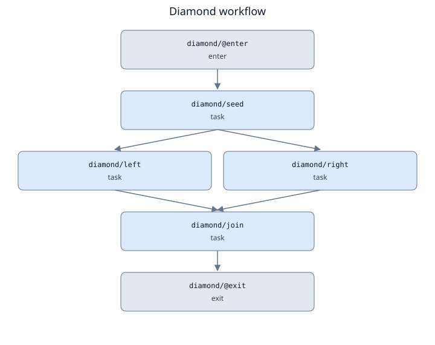
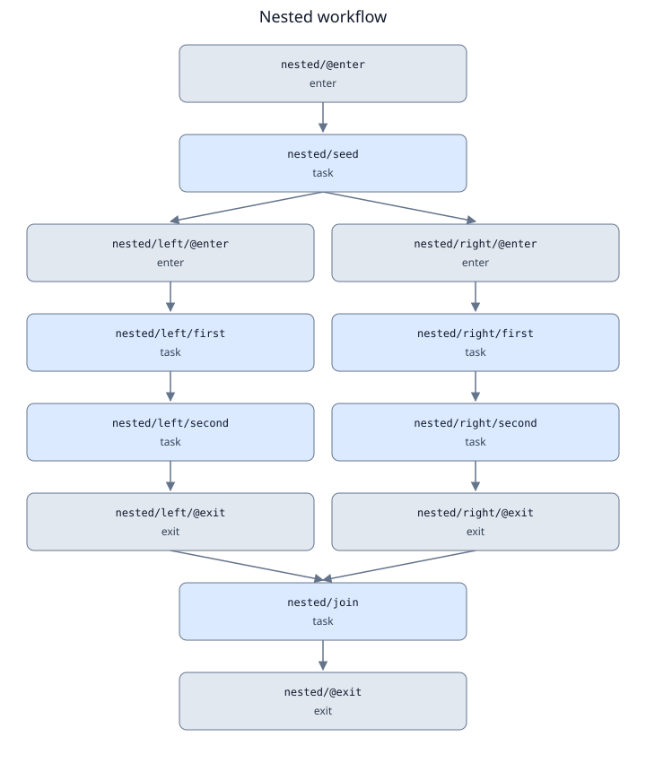
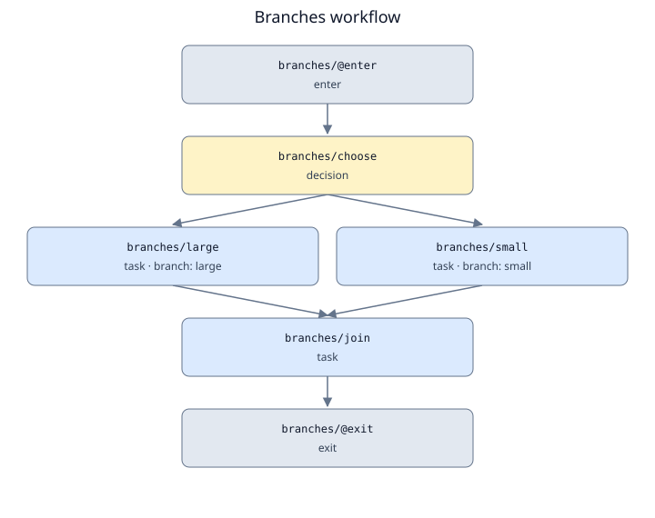
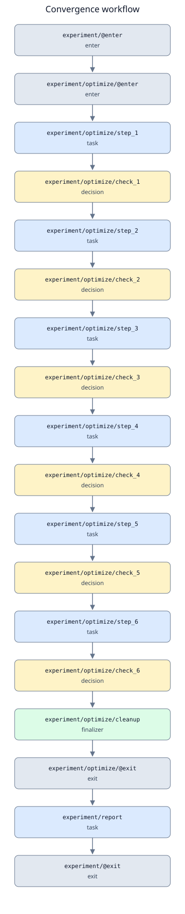
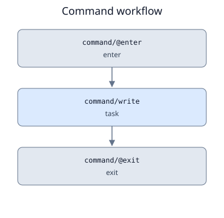
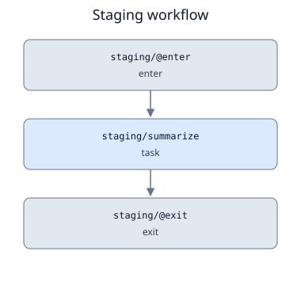

# Workflow DAGs

These diagrams come from the compiled runnable examples. Each arrow represents a dependency;
blue nodes are executable tasks, yellow nodes are coordinator decisions, grey nodes are
logical workflow boundaries, and green nodes are required finalizers. Scope boundaries
and decisions do not consume workers.

Redundant transitive edges are omitted for readability in both the DOT source and SVG
preview. This preserves dependency reachability, but the diagrams are **not execution
specifications**: direct trigger dependencies, branch guards, and early-completion rules
still come from the original compiled plan. Use `orchestrator plan` to see every dependency.
The diagrams show possible work, not the outcome of a particular run.

## Terminal dependency tree

Use `--tree` to show dependencies as branches:

```bash
uv run orchestrator plan examples/diamond.py --tree
uv run orchestrator plan examples/script.yaml --tree
```

```text
diamond — prerequisites
└── diamond/join (task)
    ├── diamond/left (task)
    │   └── diamond/seed (task)
    └── diamond/right (task)
        └── diamond/seed (task) [shared; see above]
```

Each child is a prerequisite of its parent: `join` needs both `left` and `right`, which
each need `seed`. Shared nodes are expanded once and marked on subsequent appearances;
this does not represent another execution. Independent terminal nodes appear as separate
top-level branches. Nested tasks retain their full hierarchical IDs.

The tree collapses scope barriers and omits redundant transitive edges for readability,
while preserving dependency reachability. Branch guards, non-default triggers, decisions,
and required finalizers remain labelled. Like the SVG diagrams, it is a static summary;
use the table or JSON for every direct dependency and scope barrier. `--format tree`
is equivalent to `--tree`; choose one output option per invocation.

## Terminal dependency table

Inspect a Python or YAML definition directly in the terminal with Rich:

```bash
uv run orchestrator plan examples/diamond.py --format table
uv run orchestrator plan examples/nested.py --inputs '{"start": 3}' --format table
uv run orchestrator plan examples/script.yaml --format table
```

The table shows every expanded node, its kind, and all direct prerequisites in a
deterministic topological order. Hierarchical node IDs preserve nested scope names;
`@enter` and `@exit` rows show the scope barriers. Execution details include task form,
backend, CPU settings, runner timeout when set, branch guards, triggers, required
finalizers, and scope concurrency limits. Explicit Slurm settings are shown separately
from the generic resource object because the current renderer prefers explicit Slurm values.

This is a static dependency view. Independent rows can execute in parallel; row order
does not add dependencies. The table keeps all edges rather than applying the diagrams'
transitive reduction. It does not execute application commands, create a run, or submit
jobs. Python definition files are still loaded as trusted Python, as with other planning commands.

`plan FILE` continues to emit the full JSON specification by default; use
`--format json` explicitly for machine-readable output. Use `status RUN_ID` for a
run's current states and attempt counts.

## Diamond: parallel work with a join

`examples/diamond.py` runs a seed, two independent transformations, and a join. The join
waits for both inputs; the result is `12`.



[Graphviz DOT source](../assets/dags/diamond.dot) · [Full-size SVG](../assets/dags/diamond.svg)

## Nested serial pipelines in parallel

`examples/nested.py` invokes the same child workflow twice. Each child contains a serial
pipeline; the two children can run concurrently. Their exposed outputs feed the parent join.
With `--inputs '{"start": 3}'`, the result is `24`.



[Graphviz DOT source](../assets/dags/nested.dot) · [Full-size SVG](../assets/dags/nested.svg)

## Conditional branches and a selected join

`examples/branches.py` chooses `large` or `small`. Both branches exist in the static graph,
but only the selected branch executes. `Select` and `selected_success` allow the join to
consume the available output without waiting for an intentionally skipped branch to succeed.
The supplied example selects `large` and returns `100`.



[Graphviz DOT source](../assets/dags/branches.dot) · [Full-size SVG](../assets/dags/branches.svg)

## Bounded iteration, early completion, and cleanup

`examples/convergence.py` contains six statically expanded iterations. Each decision is a
barrier before the next step. The example converges at step four: steps five and six are
skipped, cleanup executes, and the child returns `4`. The parent report then returns `8`.
All six iterations appear below because this is the definition DAG, not a run-state diagram.
The cleanup node uses `all_terminal`, so skipped iterations do not block it.



[Graphviz DOT source](../assets/dags/convergence.dot) · [Full-size SVG](../assets/dags/convergence.svg)

## Command and artifact output

`examples/command.py` runs a command that writes a file and an output manifest. The task
succeeds only after output validation; the workflow exposes the resulting file reference.



[Graphviz DOT source](../assets/dags/command.dot) · [Full-size SVG](../assets/dags/command.svg)

## Input staging and output collection

`examples/staging.py` copies a file into an isolated working directory, accepts a missing
optional input, then validates and collects a report. Staging and collection run within
the task attempt; they do not create additional workflow nodes.



[Graphviz DOT source](../assets/dags/staging.dot) · [Full-size SVG](../assets/dags/staging.svg)

## Regenerate or render the diagrams

From the repository root:

```bash
uv run python scripts/generate_dags.py
uv run mkdocs build --strict
```

The generator compiles the six examples without executing tasks, then writes `.dot`
sources and matching SVG previews under `docs/assets/dags/`. Its SVG renderer uses a
simple layered layout and only the Python standard library, so the documentation has no
additional rendering dependencies. Commit both source and preview assets after changing
examples.

If Graphviz is installed separately, render a DOT file with its layout engine:

```bash
dot -Tsvg docs/assets/dags/diamond.dot -o /tmp/diamond.svg
dot -Tpng docs/assets/dags/nested.dot -o /tmp/nested.png
```

Read [workflow combinations](workflows.md) for API examples and control semantics.
