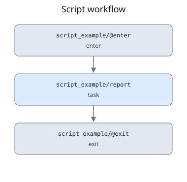

# Script tasks and job files

Use `Task(script=Script(...))` for a sequence of terminal commands sharing one
working directory, resource request, retry policy, and output contract. Script tasks
work with the same serial, parallel, nested, conditional, and bounded-iteration
[workflow combinations](workflows.md) as command and Python tasks.

For flat static graphs, [YAML definitions](yaml.md) offer the same script settings.
For example, a reusable YAML task can use:

```yaml
tasks:
  analyze:
    script:
      path: jobs/analyze.sh
      shell: bash
      inherit_env: false
    outputs:
      - name: report
        kind: file
        source: results/report.txt
nodes:
  analyze_data:
    task: analyze
```

This is a fragment: add top-level `version: 1` and `name` to make a complete definition.
Both `render` and `run` accept `.yaml`/`.yml` files as well as Python definitions.

## Run a Bash script

```python
from orchestrator import Script, Task, TaskInput, TaskOutput, Workflow

workflow = Workflow("analysis")
workflow.add("summarize", Task(
    script=Script(
        shell="bash",
        setup='export PATH="/opt/tools/bin:$PATH"',
        body='''
mkdir -p results
sort inputs/data > results/sorted.txt
wc -l < results/sorted.txt > results/count.txt
''',
    ),
    inputs=[TaskInput("data", kind="file", source="data.txt")],
    outputs=[TaskOutput("count", kind="file", source="results/count.txt")],
    env={"LC_ALL": "C"},
))
```

Save this as `workflow.py`, create `data.txt`, and run:

```bash
orchestrator render workflow.py --output preview
orchestrator run workflow.py --allow-local
orchestrator script RUN_ID analysis/summarize
orchestrator script RUN_ID analysis/summarize --attempt 1
```

Preview creates a new directory and never submits work. Preview identities and paths
are illustrative; previews have no execution manifests and cannot run as managed jobs.
`script` prints the retained attempt file after checking its hash against the durable
submission intent. `inspect`, `logs`, `resume`, retries, and cancellation also work as usual.

## Use an existing file

```python
job = Task(script=Script(path="jobs/analyze.sh", shell="bash"))
```

Choose exactly one of `body` and `path`. In Python, paths resolve against the coordinator's
current working directory when compiling. Construct paths relative to `__file__` for
workflow-file-relative behavior. In YAML, relative `script.path` values resolve against
the YAML file's directory. Compilation captures UTF-8 source and its SHA256;
subsequent edits to the source do not change an existing run or its retries.

A source shebang may be `/usr/bin/env bash` or an absolute Bash path, with analogous
forms for Zsh and Fish. It must match the declared shell and cannot include options.
Without a shebang, the compiler resolves the shell from PATH, or uses your explicit
absolute `interpreter`. That path must exist on the execution host.

Each attempt retains:

| File | Purpose |
| --- | --- |
| `job.sh`, `job.zsh`, or `job.fish` | Exact execution script: interpreter, scheduler settings, provenance, I/O summaries, lifecycle call, environment setup, and commands |
| `source.script` | Original source captured at compilation |
| `script.json` | Script/source hashes, interpreter, backend, and exact submission arguments |
| `input.json`, `staged-inputs.json` | Original and staged bindings |
| `stdout.log`, `stderr.log`, `result.json` | Logs and managed outcome |

Do not call the internal `--application` argument yourself: it bypasses the managed
lifecycle. To execute again, create a new run rather than manually re-running a retained job.

??? info "Theory: A visible worker lifecycle"

    The top-level script invokes the installed runner, which stages inputs once and calls
    the same script with `--application` to execute its environment and application section.
    It validates/collects outputs and publishes the result; the coordinator then owns the
    orchestration decision. Application status and publication are distinct observations.

    Read more: [The execution boundary](../fundamentals/contracts.md#scripts-make-the-execution-boundary-visible).

Application dependencies, module systems, and sourced setup files must be available
on the execution host. Small value outputs can be written to `ORCHESTRATOR_OUTPUTS`;
file outputs can use static `TaskOutput.source` paths.

??? info "Theory: Recorded provenance has a boundary"

    Retaining the script, interpreter path, and specification digest makes commands
    inspectable. It does not install or snapshot packages, sourced files, inherited values,
    or dataset contents. Reproducibility requires managing those external dependencies too.

    Read more: [Provenance and reproducibility](../fundamentals/philosophy.md#make-reproducibility-explicit).

## Shells and environments

| Shell | Failure behavior |
| --- | --- |
| Bash | Generated `set -euo pipefail`; ordinary failing commands and pipelines stop execution, subject to Bash's conditional/error-handling rules |
| Zsh | Generated `set -euo pipefail`, with Zsh's own conditional/error-handling rules |
| Fish | Native Fish semantics; use `command; or exit $status` to stop after each required command, and inspect `$pipestatus` for pipelines |

```python
fish_job = Task(script=Script(
    shell="fish",
    inherit_env=False,
    setup="set -gx PATH /opt/tools/bin /usr/bin /bin",
    body="prepare inputs/data; or exit $status\nanalyze; or exit $status",
))
```

Fish does not have Bash's `errexit` mode. Arbitrary shell programs are preserved rather
than translated: an unguarded earlier failure followed by a successful command can
produce a successful exit. The managed runner uses the final shell status plus output
validation. Write explicit checks for required steps, especially Fish pipelines.

`inherit_env=True` inherits the worker environment; `False` gives the application a
clean environment with a default system PATH and the two orchestrator manifest variables.
`Task.env` assignments are rendered with shell-specific quoting, then `setup` runs,
then the authored body. Put module initialization, module loads, virtual-environment
activation, PATH changes, and `srun` invocations in `setup` or the body. Module commands
are shell-specific; they are not assumed to be available in a noninteractive shell.

Ambient environment values are not serialized. Explicit `Task.env` values and source
text are retained in plaintext: refer to runtime-supplied credentials rather than
embedding secrets in either. Environment inheritance records a policy, not a reproducible
snapshot of every variable or installed package.

## Slurm submission (experimental)

```python
cluster_job = Task(script=Script(
    shell="bash",
    backend="slurm",
    slurm={"partition": "compute", "account": "research",
           "cpus-per-task": "8", "mem": "16G", "time": "01:00:00"},
    setup="source /etc/profile.d/modules.sh\nmodule load simulation/1.2",
    body="srun simulate --input inputs/data --output results",
))
```

Supply input/output contracts as in the local example. A Slurm-only workflow does not
need `--allow-local`. Mixed workflows require it for their local tasks. The coordinator
uses `sbatch --parsable` on the exact retained file, `squeue` to observe active jobs, and
`scancel` for cancellation. It never silently falls back to local execution.

An imported script can include static `#SBATCH --name=value` or `#SBATCH --name value`
lines before executable statements. Supported options are partition, account, qos,
nodes, ntasks, ntasks-per-node, cpus-per-task, mem, mem-per-cpu, time, gpus, gres,
constraint, reservation, and exclusive. Values are strings; `exclusive` may use an empty
string. Short options, repeated options, shell expansion, whitespace in values, and
unsupported directives are rejected. Imported and structured options cannot overlap.
The renderer owns job identity, comment, chdir, export policy, and stdout/stderr paths.
`Resources.cpus` supplies cpus-per-task only when no explicit Slurm setting exists;
`Resources.timeout_seconds` remains a runner timeout, separate from Slurm wall time.

All directives precede executable statements. Attempt/log directories exist before
submission. Ambient `SBATCH_*` overrides are removed from the submit environment.
Slurm attempt paths currently cannot contain whitespace or percent tokens. All required
paths, Python packages, interpreters, application tools, and input data must be accessible
on compute nodes at the recorded absolute locations. No data transport is provided.

!!! warning "Qualification and recovery limits"

    This adapter has mocked scheduler tests, not a real-cluster qualification. It supports
    a single cluster and shared filesystem. Site profiles, hierarchical Slurm overrides,
    accounting-based reconciliation, and job discovery
    after a lost acknowledgement remain future work. Qualify filesystem locking and
    durability on the single coordinator host before deployment; do not assume an arbitrary
    network filesystem is suitable for SQLite.

    A missing acknowledgement or a job disappearing without a valid result becomes
    `uncertain`, including scheduler kills where the runner cannot publish a result.
    It is never automatically resubmitted. `resume` can accept a later valid result;
    it cannot yet recover a lost job ID through scheduler accounting.

Task/workflow [directory bases](directories.md) can separate attempt storage from local
SQLite. The retained Slurm header uses each attempt's resolved working and log paths;
both the coordinator and compute nodes must access those same locations.

## Example workflow DAG

The runnable `examples/script.py` keeps directory preparation and report generation
in a single task. Split commands into multiple tasks when they need separate retry
or resource policies.



[Graphviz DOT source](../assets/dags/script.dot)
