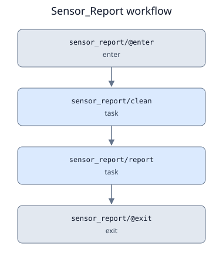

# Orchestrator

Orchestrator separates workflow definitions from execution. Python or static YAML builds a versioned
specification; a single coordinator schedules subprocess runners and records decisions,
attempts, results, and events.

This version supports **Linux local execution** with retained Bash/Zsh/Fish job files
and an experimental Slurm adapter. Cluster qualification, remote staging, and service
hosting remain future milestones.

## Run a workflow

- [Quick start](getting-started/quickstart.md): install, run an example, and write a workflow.
- [Practical workflows](getting-started/practical-workflows.md): clean sensor readings and summarize application logs.

## Understand the fundamentals

[Fundamentals](fundamentals/index.md) explains the philosophy and basic computer science:
definitions versus executions, compilation, DAGs and partial orders, contracts, state
machines, and durable recovery. Read it in sequence or follow a **Theory** box from a
guide. Those boxes are collapsed by default so procedures remain easy to follow.

## Configure and operate

- [YAML definitions](guide/yaml.md): static text input, reusable tasks, named steps, and output bindings.
- [Workflow combinations](guide/workflows.md): serial and parallel work, nesting, branches,
  bounded iteration, retries, and finalizers.
- [Workflow DAGs](guide/dags.md): diagrams and Graphviz `.dot` sources for runnable examples.
- [Script tasks and Slurm](guide/scripts.md): self-describing job files, environments, and shell commands.
- [Tasks and artifacts](guide/tasks.md): input/output contracts for scripts, Python callables, and commands.
- [Operations and recovery](guide/operations.md): CLI commands, durable state, and restart behavior.
- [Execution directories](guide/directories.md): absolute, root-relative, and parent-relative bases with isolated attempts.

## Look up implementation details

- [Architecture and status](reference/architecture.md): state transitions, assumptions, and limitations.
- [API reference](reference/api/index.md): generated class, function, method, signature, and source documentation.
- [Development and CI](reference/development.md): locked dependencies, local checks, and GitHub Actions coverage.

